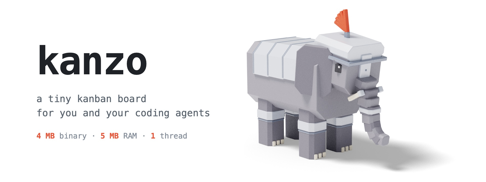
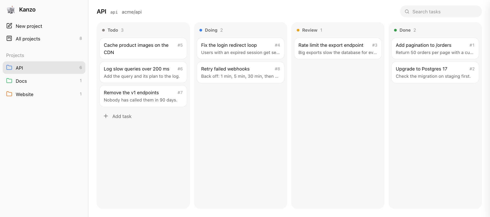
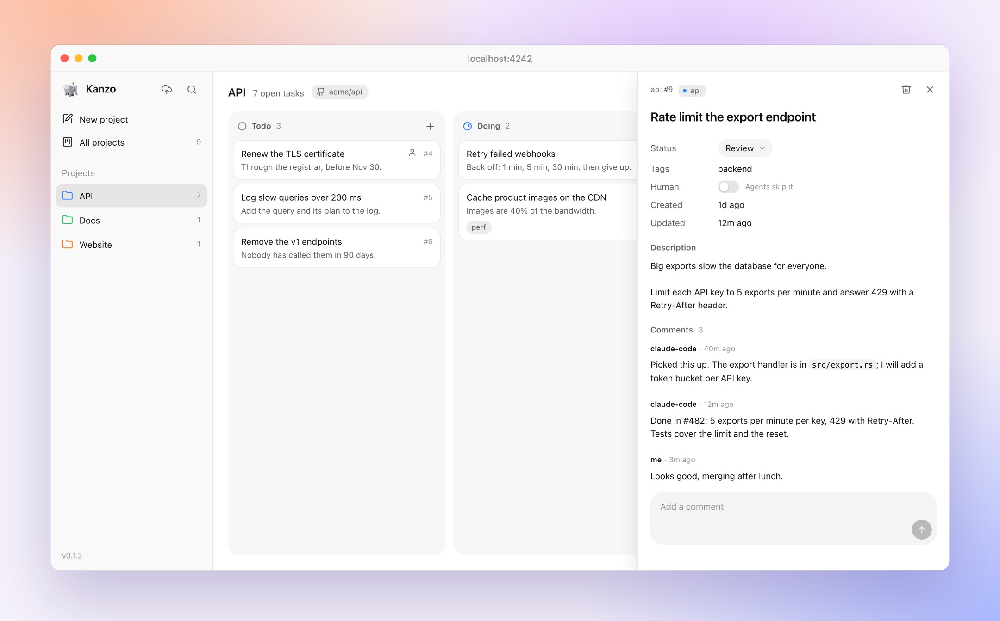

<p align="center">
  <picture>
    <source media="(prefers-color-scheme: dark)" srcset="docs/img/kanzo-dark.jpg">
    
  </picture>
</p>

<p align="center">
  <a href="https://github.com/emanuele-em/kanzo/actions/workflows/ci.yml"></a>
  
</p>

Kanzo is one small program. It shows a kanban board in your browser, and it is an MCP server, so Claude Code, Codex and other agents work on the same tasks you see. Everything is in one folder.

<picture>
  <source media="(prefers-color-scheme: dark)" srcset="docs/img/board-dark.jpg">
  
</picture>

## Get started

```sh
curl -LsSf https://github.com/emanuele-em/kanzo/releases/latest/download/kanzo-installer.sh | sh

kanzo                                            # the board, at http://localhost:4242
claude mcp add kanzo --scope user -- kanzo mcp   # connect Claude Code
codex mcp add kanzo -- kanzo mcp                 # connect Codex
```

Then ask your agent: *"take the next task from kanzo and do it."* It moves the card to `doing` and comments as it works. Agents find the right project from the repo they work in.

<picture>
  <source media="(prefers-color-scheme: dark)" srcset="docs/img/task-dark.jpg">
  
</picture>

## Easy to use

- **One panel for every task.** Title, description and status are edited in place and saved as you go. No forms, no save buttons.
- **Keyboard first.** `n` adds a task, `/` searches, `Tab` moves to the description, `⌘↵` saves and closes, `Esc` cancels.
- **Live.** What agents do shows up on the board within 2 seconds.
- **Nothing to set up.** Projects, four columns, Markdown and comments; light and dark follow your system.

## Fast and light

| What | Measured |
| --- | --- |
| Program size | 4.3 MB, SQLite included; no Docker, Node or database server |
| Memory | 4.4 MB idle, 9 MB with 3,000 tasks and 5,000 comments |
| Threads when idle | 1 |
| Ready after launch | 3 ms for the board, 9 ms for `kanzo mcp` |
| Board of 3,000 tasks | 3.4 ms on the server, about 17 ms to fetch and draw in the browser |
| Checking for changes, every 2 s | 0.5 ms, and no disk writes |
| An MCP tool call | 0.2 to 0.6 ms |
| The board page | 61 KB, no framework |

Measured on an Apple M4. In a Linux container limited to 64 MB of memory and half a CPU, the ARM64 build idles at 3.5 MB. It runs on macOS 10.12 or later and on any 64-bit or ARM Linux, from a Raspberry Pi Zero to a Pi 5.

## Few tokens for agents

| What the agent reads | Size |
| --- | --- |
| Tool list, once per session | 3.2 KB, about 800 tokens |
| Creating, updating or commenting a task | one line, 10 to 25 tokens |
| A task with its description and comments | about 60 tokens, plus the text itself |
| Listing tasks | one line per task; done tasks only when asked, and then the newest 20 |

Replies are short plain text, not JSON. Token counts are estimated at 4 characters per token.

## Learn more

The [guide](docs/guide.md) covers running Kanzo in the background, opening it from other devices, MCP over HTTP, syncing between laptops, export and settings.

To contribute, see [CONTRIBUTING](.github/CONTRIBUTING.md); to report a vulnerability, [SECURITY](.github/SECURITY.md). Kanzo is free software under the [AGPL-3.0](LICENSE): use it, change it and share it; if you offer a changed version to others over a network, share its source too.
