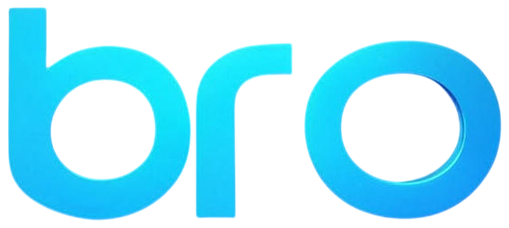

<p align="center">
  
</p>

<p align="center">
  <a href="https://github.com/ExcuseMeBro/brokan/actions/workflows/ci.yml"></a>
  <a href="LICENSE"></a>
</p>

Brokan is a kanban board in your browser and an MCP server in one small program, so you and your coding agents work on the same tasks. The whole board is one folder, and a private git repo keeps it in step on every machine you use: no account, no server.

## Install from source

Requires Rust 1.89 or newer. No Brokan release or crates.io package is assumed to be available yet.

```sh
git clone https://github.com/ExcuseMeBro/brokan.git
cd brokan
cargo install --locked --path .
```

Run `brokan` to start the board in the background and open it in your browser. The command returns to your shell once the port is ready; it does **not** close your terminal window. The board keeps running if you close the terminal. This rename does not migrate an existing board automatically; use `--home <existing-data-folder>` if you want to keep using one.

## Use

| Command | Does |
| --- | --- |
| `brokan` | Starts the board in the background at http://localhost:1317 and opens it; `--port` for another port, `--no-open` to not open it |
| `brokan --foreground` | Runs attached to the terminal until Ctrl-C; use `--no-open` to skip opening the browser |
| `brokan service install` | Keeps the board running and starts it at login; `uninstall` removes it |
| `brokan mcp` | The MCP server for agents: they start it, not you |
| `brokan sync` | Commits the board and pulls or pushes it; `--repo <url>` sets the repo, `--keep-local` or `--keep-remote` when both sides changed |
| `brokan export` | Prints the board as Markdown; `-f json` for JSON, `-p <project>` for one project, `-o <file>` to save it |
| `brokan update` | Installs the latest release and restarts the board's service; the board offers new versions too |
| `brokan init` | Creates the data folder; the first run does this too |
| `brokan --version` | Prints the version |

Every command takes `--home <dir>` to use another data folder. Background startup prints the path to its log in your system cache folder (outside the board's synced data folder). Running `brokan` again when the board is already listening will reuse it instead of starting another copy.

`n` adds a task, `/` or `⌘K` searches every project, `Tab` moves to the description, `⌘↵` saves and closes, `Esc` cancels.

Need somewhere to park ideas? Turn on the Backlog column in Settings, at the bottom of the sidebar: agents leave its tasks alone until you move them to `todo`.

Paste or drop an image into a task or a comment to attach it, as in ChatGPT. Agents get its file path and can open it.

When a new version is out, the sidebar offers it: one click installs it and restarts the board.

## Connect your agents

```sh
claude mcp add brokan --scope user -- brokan mcp   # Claude Code
codex mcp add brokan -- brokan mcp                 # Codex
```

Other MCP clients: run `brokan mcp` (apps like Raycast need the full path, from `which brokan`), or use the running board at `http://localhost:1317/mcp`.

Then ask: *"take the next task from brokan and do it."* The agent moves the card to `doing` and comments as it works. It finds the right project from the git remote of the repo it works in; link more repos to a project from its ⋯ menu.

## Your board on every machine

A laptop, a desktop, a Raspberry Pi: they all share one board through a private git repo you own.

1. [Create an empty private repo](https://github.com/new?name=brokan-data&visibility=private) on GitHub, or anywhere git can push.
2. Click Settings at the bottom of the sidebar, choose Sync and paste its URL. Brokan makes `~/brokan` a git repo and pushes the board.
3. On each other machine, do the same with the same URL: Brokan offers to use the board that's already there.

From then on, choose Sync, or run `brokan sync`, when you switch machines. It commits the board and pulls or pushes it, and it's safe while the board and your agents are running. If both machines changed the board, Brokan asks which one to keep. To move to another repo, change it in Settings, under Sync.

Sync is for switching machines: work on one, sync, then move to the other. For agents on several machines at once, run one board with `listen = "0.0.0.0"` on a network you trust, and point every agent at `http://<host>:1317/mcp`, passing the project by name.

## Settings

Everything lives in `~/brokan`: the board in `brokan.db`, settings in `config.toml`. Use another folder with `--home` or `BROKAN_HOME`.

```toml
port = 1317
listen = "127.0.0.1"   # "0.0.0.0" opens the board to your network: no logins, so only on one you trust
mcp_http = true        # MCP at /mcp
```

## License

[AGPL-3.0](LICENSE): use it, change it and share it; if you offer a changed version over a network, share its source too. To help, see [CONTRIBUTING](.github/CONTRIBUTING.md).

<sub>mcp-name: io.github.excusemebro/brokan</sub>
